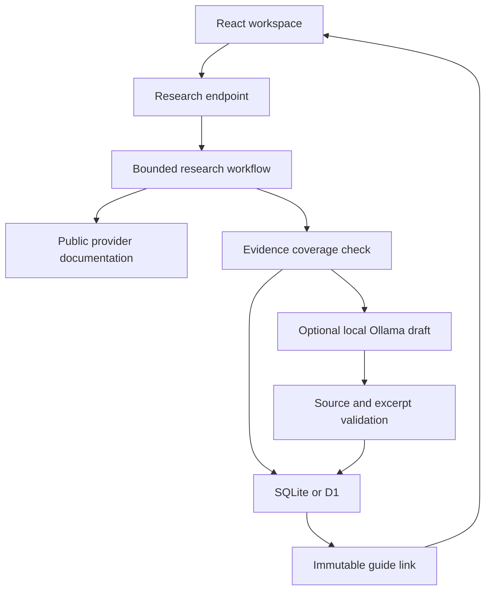

# Architecture and scope

## One vertical slice

A developer should answer: “Can I ship this integration, what could block it, and what do I do now?” The app separates registration, an individual user’s consent, workspace permission, and provider review. It does not handle customer OAuth credentials.

## Runtime

- `app/page.tsx`: library, guide, source inspection, blockers, compare, export, local progress.
- `lib/catalog.ts`: reviewed provider content, independent of generated guides.
- `lib/research.ts`: adaptive priority queue, evidence classification, coverage, reports, and model handoff.
- `lib/research-fetch.ts`: public URL/DNS checks, per-request deadlines, HTML/Markdown/JSON parsing, and bounded reading.
- `lib/discovery.ts`: broad registry hints, documentation link ranking, and free search adapters.
- `lib/synthesize.ts`: optional local model adapter with schema and evidence-reference checks.
- `app/api/research/route.ts`: same-origin boundary, input limits, idempotency, hourly limit, deadline, streaming progress, persistence.
- `app/api/guides/[id]/route.ts`: immutable guide retrieval.
- `db/schema.ts` and `drizzle/`: versioned schema, no runtime schema mutation.

Local mode uses Miniflare/workerd and SQLite. It requires no cloud account. A hosted Worker uses the same handlers with D1. Hosting authentication is provided by the deployment adapter; the local app has no identity layer and binds to loopback.

## State and failure handling

A client creates a request UUID. The server inserts a primary-keyed research run before performing work. Repeated completed IDs return the stored guide ID; running or failed IDs do not silently replay. Results use immutable UUIDs. Browser preferences never masquerade as server-persisted guides.

Independent fetches run in bounded groups of three. Redirects are revalidated, non-text responses are rejected, and each page has a size bound. A run has a deadline and propagates request cancellation. Unavailable secondary pages become trace entries; missing OAuth evidence produces an explicitly incomplete report with discovery attempts and recovery actions. A source from another product or a shared catalog never establishes OAuth support for the requested app. Model failure preserves useful extracted evidence and is recorded explicitly.

The final result is emitted only after guide content and the completed request state are committed in a database batch. There is no automatic replay or invented success. A production version should add a request-status endpoint for reconnecting to an interrupted progress stream.

## Distributed-system judgment

No broker, vector database, or microservices are needed for this slice. Database primary keys handle duplicate run identity across Worker instances. A database query provides approximate per-client throttling; concurrent requests can exceed it, so it is not a strict quota. There is no isolate-local cache used as durable state.

At sustained load: use a durable queue and job status endpoint; enforce atomic quotas; cache public source fetches with TTL and conditional requests; retain source hashes/version history; schedule targeted policy rechecks. Add these when throughput, reliability, or content maintenance requires them.

## Trust boundaries

Visitor input is never an arbitrary inference endpoint, executable prompt, raw SQL, or rendered HTML. URLs are HTTPS-only without embedded credentials, custom ports, or queries; redirects and DNS answers are checked for public reachability. Provider HTML is reduced to text and React escapes it. Ollama is configured only by the deployer; remote page text is explicitly treated as untrusted data. Generated source IDs and proof excerpts must match the retrieved material. Semantic faithfulness still needs human review.

Application DNS preflight has a time-of-check/time-of-use limit. Egress deny rules are the appropriate self-hosting defense against private-address rebinding. No claim of production SSRF completeness is made.
