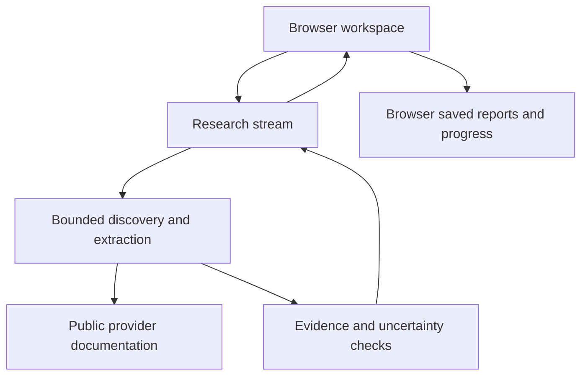

# Architecture

A single React application and a stateless research endpoint. No app authentication or database.

- `app/page.tsx`: directory, guide, comparison, source inspection, checklist, copy and export.
- `components/app-directory.tsx`: search, filters, category/collection browsing and local pins.
- `lib/research-api.ts`: same-origin JSON/body checks, streaming progress/results, cancellation, deadline, isolate-local backpressure.
- `app/api/research/route.ts`: Worker adapter for server-owned optional Ollama and SearXNG settings.
- `app/api/guides/[id]/route.ts`: the four reviewed guides only. No legacy server-data fallback.
- `lib/research.ts`, `discovery.ts`, `research-fetch.ts`: provider identity, prioritized public-doc discovery, safe bounded retrieval, evidence classification and recovery reports.
- `lib/synthesize.ts`: optional local model drafts with source/excerpt validation.

Generated reports stream to the browser and are saved in localStorage, capped at the latest 50. Checklist and pins are also local. There is no app account, server persistence or cross-device synchronization. Export/copy Markdown for portable sharing; only reviewed catalog links are portable across browsers. Source review dates do not claim account eligibility or a tested token exchange.

The Request/Response app runs on a hosted Worker or locally under workerd/Miniflare. No database binding or migration is needed. Old D1 records are not queried and are not deleted by this change.

Independent reads run in bounded groups of three. Each redirect is revalidated, private/reserved destinations are rejected, and raw provider HTML is reduced to escaped text. Shared catalog entries locate provider docs but cannot prove another product supports OAuth. Model output cannot invent citations. DNS rebinding remains an application preflight limitation; enforce egress restrictions when self-hosting.

A run has a three-minute deadline. Disconnect/cancellation aborts retrieval. Best-effort capacity is four active runs per Worker isolate; this is not an IP quota or a global rate limiter. Repeated requests can run again; there is no durable idempotency or background job recovery. Stream failure is explicit and never presented as a completed report.
